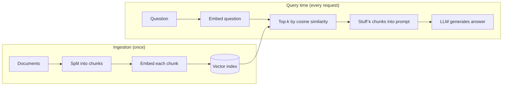
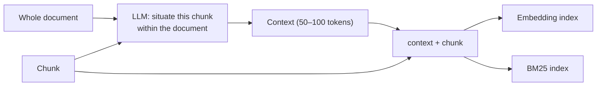
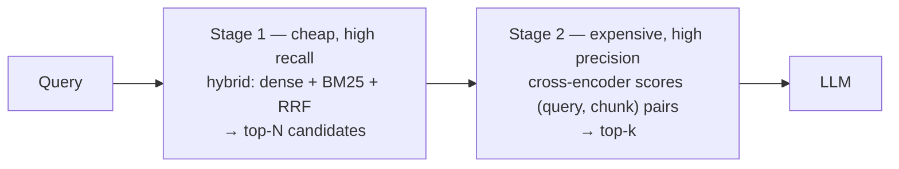
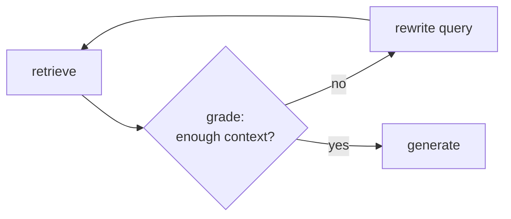

# Block 1 — Watch: from naive RAG to contextual, hybrid and agentic retrieval

> **Goal of this block.** Understand, from first principles, *why* naive RAG fails and the three
> families of answers the field has converged on: **fix the representation** (Contextual
> Retrieval), **fix the ranking** (hybrid search + reranking), and **let the model drive the
> search** (agentic retrieval, A-RAG). No benchmark numbers of our own here; those come in Block 2.
>
> **Prerequisites.** Comfortable with Python and basic ML (vectors, dot products, train/test).
> No prior information-retrieval (IR) knowledge assumed.
>
> **Material.** This course · [notebook](notebooks/01_retrieval_fundamentals.ipynb) (executed, toy
> corpus) · [cheat-sheet](cheatsheet.md) · [exercises](exercises.md) · code in
> [`src/ragbench/lexical.py`](../../src/ragbench/lexical.py) and
> [`src/ragbench/fusion.py`](../../src/ragbench/fusion.py).

## Sources

| # | Source | Why it matters |
|---|--------|----------------|
| S1 | Anthropic, [*Introducing Contextual Retrieval*](https://www.anthropic.com/engineering/contextual-retrieval) (2024) | The canonical, quantified technique: contextual embeddings + contextual BM25 + reranking |
| S2 | Du et al., [*A-RAG: Scaling Agentic RAG via Hierarchical Retrieval Interfaces*](https://arxiv.org/abs/2602.03442) (arXiv 2602.03442, Feb 2026) | The frontier: give the model retrieval tools instead of a fixed pipeline |
| S3 | Young Gao, [*RAG Is Not Dead: Advanced Retrieval Patterns That Actually Work in 2026*](https://dev.to/young_gao/rag-is-not-dead-advanced-retrieval-patterns-that-actually-work-in-2026-2gbo) (dev.to, Mar 2026) | The practitioner's toolbox, with code: hybrid, reranking, query transformation, agentic loop |

---

## 1. What RAG is, and what "retrieval quality" means

### 1.1 The problem RAG solves

A language model only knows what was in its training data, frozen at a cutoff date, and it cannot
cite where a fact came from. **Retrieval-Augmented Generation (RAG)** adds a step: before answering,
fetch relevant passages from *your* documents and put them in the prompt. The model then answers
*from* those passages, and can cite them.

S1 adds a useful first rule: **if your whole knowledge base fits in the prompt (under ~200,000
tokens, about 500 pages), skip RAG.** Put everything in context and use prompt caching. RAG is
for corpora too large for that, like the thousands of filings of an asset manager.

### 1.2 The naive pipeline



Four steps: **chunk → embed → top-k → generate**. Anyone can build it in an afternoon, and that
is the point of the mini-plan: it is a commodity. The value is in making it *reliably right*.

### 1.3 Two stages, two kinds of failure

A wrong answer has one of two causes, and they need opposite fixes:

| Failure | What happened | Fix lives in |
|---|---|---|
| **Retrieval failure** | The passage containing the answer was not in the top-k | chunking, representation, ranking |
| **Generation failure** | The right passage was there, but the model misread, ignored or contradicted it | prompt, model, grounding checks |

If you only look at final answers, you cannot tell them apart, and you end up "improving the
prompt" while the right chunk never reached the model. **This whole project measures retrieval on
its own**, by asking one question: *was the golden chunk retrieved?*

### 1.4 Retrieval metrics you need now

Assume each test question has one known **golden chunk** (the one that contains the answer).

- **Pass@k** (also called *hit rate@k*): the fraction of questions whose golden chunk appears in the
  top-k results. With one golden chunk per question, Pass@k equals **recall@k**.
- **recall@k** in general: the fraction of *all* relevant chunks that made it into the top-k,
  averaged over questions. It differs from Pass@k when a question needs several chunks.
- **Failure rate@k = 1 − recall@k**. This is the metric S1 reports, at k = 20.
- **Relative reduction**: if the failure rate drops from 5.7 % to 2.9 %, the reduction is
  (5.7 − 2.9) / 5.7 = **49 %**. Watch out: that is *relative*. In absolute terms, it is 2.8 points.

> **Why k matters.** Larger k raises recall (more chances to include the golden chunk) but sends
> more text to the LLM: more cost, more latency, and more distractors. S1 found k = 20 better than
> 5 or 10 for their setup. The right k is something you measure.

---

## 2. Fundamentals: dense and lexical retrieval

### 2.1 Embeddings and cosine similarity (dense retrieval)

An **embedding model** maps a piece of text to a vector of a few hundred numbers (384 for
`bge-small`, 768 for `bge-base`). It is trained so that texts with similar meaning land close to
each other. Retrieval then becomes geometry: rank chunks by **cosine similarity** with the query
vector.

$$\cos(q, d) = \frac{q \cdot d}{\lVert q \rVert\,\lVert d \rVert}$$

With L2-normalized vectors (norm 1), this is just a dot product, so scoring a million chunks is
one matrix–vector multiplication.

This architecture is called a **bi-encoder**: query and document are encoded *separately*, so
document vectors can be computed once at ingestion. That is what makes it fast. It is also what
limits it: the query never "sees" the document, and all the nuance of a passage must be squeezed
into one vector.

**Strengths:** paraphrases and synonyms ("share buyback" ↔ "repurchased shares").
**Weaknesses:** rare identifiers (`KX-4417` vs `KX-4471`, `ASC 842`), exact numbers, acronyms the
model has rarely seen. The vector for an unknown code is often close to the vector for a
*similar-looking* code.

> **Pitfall.** BGE models expect a fixed instruction prefix on the *query* side
> (`"Represent this sentence for searching relevant passages: "`). Forgetting it does not crash
> anything. It just makes retrieval quietly worse.

### 2.2 BM25 (lexical retrieval)

**BM25** ranks documents by the words they literally share with the query. It refines TF-IDF with
two ideas. For a query $q$ and a document $d$:

$$\text{BM25}(q,d)=\sum_{t\in q}\text{IDF}(t)\cdot\frac{tf(t,d)\,(k_1+1)}{tf(t,d)+k_1\left(1-b+b\,\dfrac{|d|}{\text{avgdl}}\right)}$$

Read it term by term:

| Piece | Meaning | Intuition |
|---|---|---|
| $tf(t,d)$ | occurrences of term $t$ in $d$ | more mentions → more relevant… |
| $k_1$ (≈ 1.2–2.0) | **saturation** | …but the 10th mention adds far less than the 1st |
| $\lvert d \rvert / \text{avgdl}$ | document length relative to average | long documents contain more words by chance |
| $b$ (≈ 0.75) | **length normalization** strength | $b=1$: fully penalize length; $b=0$: ignore it |
| $\text{IDF}(t)=\ln\frac{N-n_t+0.5}{n_t+0.5}$ | rarity of $t$ across the $N$ documents ($n_t$ contain it) | rare words are informative; "the" is not |

Two consequences matter for finance:

- **A rare token dominates.** In the notebook, the query `KX-4417 borrowing limit` is tokenized to
  `kx`, `4417`, `borrowing`, `limit`. `4417` appears in a single document and contributes most of
  the score. BM25 separates `KX-4417` from `KX-4471` by a factor of about 2.4, where dense retrieval
  separates them by 0.04 in cosine.
- **No literal match, no score.** `share buyback` scores **zero** against "repurchased 2.1 million
  shares": "buyback" never appears, and our tokenizer does not stem "shares" to "share".

### 2.3 A detail worth knowing: the IDF floor

When a term appears in more than half of the documents, its raw IDF is **negative**: it would
*lower* the score of documents containing it. `rank-bm25` (and our implementation, which matches
it exactly) replaces negative IDFs with $\varepsilon \times \text{mean IDF}$ ($\varepsilon=0.25$).
On real corpora that floor is a small positive number. On tiny toy corpora where most terms are
frequent, the mean itself can be negative, and so can the floor. Our test suite pins this
behaviour down (`test_idf_floor_can_be_negative_on_tiny_corpora`). It is a good example of
"check the reference implementation, not just the textbook formula."

### 2.4 Dense vs lexical, side by side

| | Dense (bi-encoder) | BM25 |
|---|---|---|
| Matches | meaning | exact tokens |
| Wins on | paraphrases, synonyms, vague questions | codes, tickers, numbers, legal references, rare names |
| Loses on | rare identifiers, unseen acronyms | synonyms, inflections, paraphrases |
| Index | vectors (GPU/ANN index) | inverted index (cheap) |
| Tunables | model choice, prefix, chunking | $k_1$, $b$, tokenizer, stemming |

They fail on *different* queries. That is the whole argument for combining them.

---

## 3. Why naive RAG fails

S3 lists four failure modes. We add the one at the core of S1:

1. **Chunking breaks meaning.** A fixed 512-token window cuts paragraphs, separates a question from
   its answer, and, crucially for finance, **slices tables** so that a cell loses its row and
   column headers.
2. **Chunks lose their context** (S1's central point). Take *"The company's revenue grew by 3 % over
   the previous quarter."* Which company? Which quarter? The chunk is accurate but no longer
   *findable*: a query about "ACME Q2 2023 revenue" shares neither the name nor the period with it.
3. **Similarity ≠ relevance.** A chunk can be semantically close to the question but not answer it.
4. **Top-k is crude.** The k most *similar* chunks are not necessarily the k most *useful*.
5. **No query understanding.** The raw user question goes straight to vector search, with its typos,
   ambiguity and multiple sub-questions.

Each of the following sections fixes one or more of these.

---

## 4. Contextual Retrieval (S1): fix the representation

### 4.1 The idea

Before indexing, ask an LLM to write a **short context (≈ 50–100 tokens) that situates each chunk
within its document**, and prepend it to the chunk. Then build *both* indexes on the
contextualized text:

- **Contextual Embeddings**: embed `context + chunk` instead of `chunk`.
- **Contextual BM25**: index `context + chunk` in BM25.



Before: *"The company's revenue grew by 3 % over the previous quarter."*
After: *"This chunk is from ACME Corp's SEC filing on Q2 2023 performance; the previous quarter's
revenue was $314 million. The company's revenue grew by 3 % over the previous quarter."*

Now "ACME", "Q2 2023" and "revenue" are in the indexed text. The chunk can be found by both the
dense and the lexical retriever.

### 4.2 The prompt

S1 uses Claude 3 Haiku with this prompt (reproduced in substance):

```text
<document>
{{WHOLE_DOCUMENT}}
</document>
Here is the chunk we want to situate within the whole document
<chunk>
{{CHUNK_CONTENT}}
</chunk>
Please give a short succinct context to situate this chunk within the overall document for the
purposes of improving search retrieval of the chunk. Answer only with the succinct context and
nothing else.
```

The **whole document** goes into every call. That would be prohibitively expensive without the
next trick.

### 4.3 Why prompt caching makes it affordable

All chunks of one document share the same long prefix (the document). With **prompt caching**, that
prefix is processed once and reused for every chunk of the document. Only the short chunk part
changes. S1's estimate, with 800-token chunks, 8k-token documents, 50 tokens of instructions and
100 tokens of output: **about $1.02 per million document tokens, paid once at ingestion.**

That is the key economic contrast for Block 3:

- **Contextual Retrieval**: cost paid **once per chunk at ingestion**, re-paid only when you re-index.
- **Reranking**: cost paid **on every query**.

### 4.4 The results, read carefully

Setup in S1: several domains (codebases, fiction, arXiv papers, science papers), several embedding
models, metric **1 − recall@20** (failure rate at top-20).

| Configuration | Failure rate @20 | Relative reduction |
|---|---|---|
| Baseline embeddings | 5.7 % | — |
| + Contextual Embeddings | 3.7 % | −35 % |
| + Contextual BM25 (hybrid) | 2.9 % | **−49 %** |
| + Reranking (top-150 → top-20, Cohere) | 1.9 % | **−67 %** |

How to read it:

- The famous **49 %** and **67 %** are *relative* reductions of a failure rate that was already low
  (5.7 %). In absolute terms: −2.8 and −3.8 points.
- The layers **stack**: context helps embeddings, lexical matching on contextualized chunks helps
  more, reranking helps more again.
- Contextualization helped **every** embedding model tested. Gemini and Voyage benefited most.

### 4.5 S1's practical advice

- **Chunking still matters**: size, boundaries and overlap all change the outcome.
- **Customize the prompt** for your domain. For example, include a glossary of terms defined
  elsewhere in the knowledge base. (In the notebook, a context mentioning "CECL" would have rescued
  the query that both retrievers missed.)
- **More chunks is not free**: more context raises recall but can distract the model.
- **Always run evals** on your own data.

S3 shows a cheaper variant: the LLM sees only the **first 2,000 characters** of the document
instead of all of it. It costs less, but the context will be poorer for chunks deep in a long
filing. That is a trade-off worth measuring rather than assuming.

---

## 5. Hybrid search, RRF and reranking (S1, S3): fix the ranking

### 5.1 Hybrid search

Run dense **and** BM25 retrieval, then merge the two ranked lists. Each catches what the other
misses (§2.4). The merge is the tricky part: BM25 scores are unbounded (0 to 30+) and cosine
similarities live in [−1, 1]. Adding them is meaningless without normalization, and normalization
is fragile.

### 5.2 Reciprocal Rank Fusion (RRF)

RRF sidesteps scores entirely and uses **ranks**:

$$\text{RRF}(d)=\sum_{\text{lists }L} \frac{1}{k+\text{rank}_L(d)}\qquad(k=60\text{ by convention, Cormack et al., 2009})$$

- A document ranked well in **both** lists accumulates two contributions.
- $k$ dampens the top: with $k=60$, rank 1 is worth $1/61$ and rank 10 is worth $1/70$, only 1.15×
  less. Consensus matters more than a single first place. With $k=0$, rank 1 is worth 10× rank 10.
- S3's example: a document ranked 1st and 3rd beats one ranked 2nd and 2nd, but only barely
  (0.032266 vs 0.032258). Our tests check exactly that.

Implementation: [`ragbench.fusion.rrf_fuse`](../../src/ragbench/fusion.py), about ten lines.

> **Pitfall seen in the notebook.** If BM25 scores *every* document zero, its "ranking" is just
> corpus order, and feeding it to RRF injects noise. Only pass documents with a positive score.

S3 instead uses LangChain's `EnsembleRetriever` with weights 0.6 (vector) / 0.4 (BM25). That is
weighted RRF. The weights are one more hyperparameter to validate, not a universal constant.

### 5.3 Cross-encoder reranking

A **cross-encoder** reads the query **and** a candidate passage *together* in one forward pass
and outputs a relevance score. Since every token of the query can attend to every token of the
passage, it judges relevance far more finely than a bi-encoder comparing two independent vectors.

The price: nothing can be precomputed. Scoring N candidates means N forward passes **per query**.
Hence the **two-stage pattern**:



| Source | Stage 1 → Stage 2 |
|---|---|
| S1 | top-150 → top-20 (Cohere reranker) |
| S3 | top-20 → top-5 (Cohere `rerank-english-v3.0`) |
| Our Block 2 | top-50 → top-k (`BAAI/bge-reranker-v2-m3`, local GPU) |

The reranker can only reorder what stage 1 found. **Stage 1 must maximize recall; stage 2
maximizes precision.** S3 also mentions **ColBERT v2** (late interaction, one vector per token) as
a middle ground: close to cross-encoder quality at close to bi-encoder speed.

---

## 6. Query-side patterns (S3)

Instead of improving the index, improve the query:

- **HyDE**: let the LLM write a *hypothetical answer*, then embed and search with that. Answers look
  more like documents than questions do.
- **Multi-query expansion**: generate 3+ rephrasings, search with each, deduplicate.
- **Step-back prompting**: also search with a more general version of the question.

All three cost an LLM call **per query** and add latency. They are not part of our benchmark but
belong in the toolbox.

---

## 7. Agentic retrieval: let the model drive the search

### 7.1 From workflow to agent

Everything so far is a **fixed workflow**: the same retrieval steps run for every question.
**Agentic RAG** gives the LLM retrieval **tools** and lets it decide what to search, read whether
the results are enough, and search again if not.

S3 shows the simplest agentic loop, as a LangGraph state machine:



### 7.2 A-RAG (S2): hierarchical retrieval interfaces

A-RAG pushes the idea further: no predefined workflow at all, just **three tools at different
granularities**, and the model decides how to combine them.

| Tool | Input | Returns | Level |
|---|---|---|---|
| `keyword_search` | 1–3-word keywords, `top_k` (default 5, max 20) | chunk IDs + matching sentences as snippets | keyword |
| `semantic_search` | natural-language query, `top_k` | chunk IDs + best-matching sentences as snippets | sentence |
| `chunk_read` | chunk IDs | full chunk text (can also read neighbours ±1) | chunk |

Design details worth noticing:

- **Progressive disclosure.** Searches return *snippets*, not full chunks. The model reads a full
  chunk only when a snippet looks promising. That keeps the context small.
- **`semantic_search` works at sentence level**: every sentence is embedded and points to its
  parent chunk (≈ 1,000-token chunks). A chunk's score is its best sentence.
- **`keyword_search` is not BM25.** It is exact, case-insensitive matching at query time, scored by
  *occurrences × keyword length*. There is no index to build.
- **Context tracker.** Re-reading an already-read chunk returns a short notice instead of the text.
- **Loop.** ReAct-style (reason → one tool call → observe). It stops when the model answers without
  calling a tool, or when the step budget runs out (then it must answer with what it has).

### 7.3 What A-RAG shows (and does not)

On multi-hop QA benchmarks (MuSiQue, HotpotQA, 2WikiMultiHopQA, GraphRAG-Bench), A-RAG (Full)
beats naive RAG and graph-based methods on most columns, especially with a strong reasoning model.
With GPT-5-mini it reaches 74.1 % LLM-accuracy on MuSiQue vs 52.8 % for naive RAG. Other findings:

- **Progressive disclosure is what keeps it cheap.** A-RAG (Naive), which has only an embedding tool
  and no snippets, consumes 4–10× more retrieved tokens.
- **Scaling.** A larger step budget (5 → 20) and higher reasoning effort both improve accuracy. The
  method is designed for capable tool-using reasoning models.
- **Failure modes shift.** For naive RAG, about half the errors come from retrieval. For A-RAG,
  most errors become *reasoning* errors (82 % on MuSiQue), often entity confusion. Better retrieval
  moves the bottleneck; it does not remove it.

### 7.4 When to escalate (preview of Block 3)

Agentic retrieval costs more tokens and has **unpredictable latency** (variable number of steps).
The default stays the fixed pipeline. Escalate when questions are **multi-hop**, when the first
retrieval is often insufficient, or when sources are heterogeneous. Always **bound the loop** and
define the stop condition: *"insufficient context → say so or escalate"*, never *"make something
up"*.

---

## 8. How this prepares Block 2

| Concept from this block | Becomes in Block 2 |
|---|---|
| Golden chunk, Pass@k, recall@k | The evaluation harness (`eval_retrieval`) on FinQA |
| Dense bi-encoder | `retrieve_dense` with `bge-base-en-v1.5` |
| BM25 | `retrieve_bm25` with `ragbench.lexical.BM25` |
| RRF | `rrf_fuse` (already written and tested) |
| Cross-encoder, two-stage | `rerank` with `bge-reranker-v2-m3`, top-50 → top-k |
| Contextual Retrieval | 4th configuration: contextualized chunks via local LLM, then Claude |
| Chunking breaks tables | Naive vs table-aware chunking, compared head-to-head |
| Thin dense margins on identifiers | Looking for real FinQA queries where BM25 rescues dense |

---

## 9. Deviations from the plan

The study plan summarized these sources. Reading them in full turned up these differences:

1. **Metric.** The plan mentions Pass@k on 248 queries. That is the setup of the Claude *cookbook*.
   The *article* (S1) reports **1 − recall@20** across several domains. Same family of metric,
   different setup: the 49 % / 67 % figures are recall@20 failure-rate reductions. The cookbook
   figures (e.g. ~92 % Pass@10) were not re-checked in this block; Block 3 will treat them as
   hypotheses.
2. **"49 %" and "67 %" are relative.** From a 5.7 % baseline failure rate, that is −2.8 and −3.8
   points. Still large, but it matters when you present it to a client.
3. **A-RAG's token budget.** The plan says A-RAG wins "at comparable or lower compute budget". The
   paper's token table shows fewer retrieved tokens than naive RAG on 2 of 5 benchmarks (HotpotQA,
   2Wiki) and somewhat more on the other 3. A-RAG is also not best on every column: with GPT-4o-mini,
   HippoRAG2 beats it on HotpotQA LLM-accuracy.
4. **A-RAG's keyword tool is not BM25.** It is exact matching weighted by keyword length, with no
   index. Our L2 POC can still use BM25 behind a `keyword_search` tool, but that will be *our*
   design choice, not A-RAG's.
5. **S3 does not state the RRF constant.** We use k = 60, the value from the original RRF paper.
6. **The "dense misses, BM25 rescues" demo.** On our 12-sentence toy corpus, dense retrieval never
   ranked the wrong *identifier* first. It was right on `KX-4417`, just with a 0.04 margin. The
   clear failures we found were a paraphrase (BM25 misses) and an unseen acronym (both miss). The
   claim "dense misses exact terms" is therefore a claim about **large, near-duplicate corpora**,
   and Block 2 must demonstrate it on FinQA rather than assume it.
